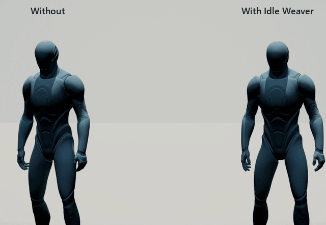
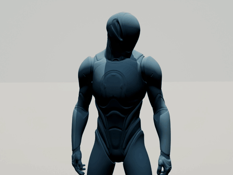
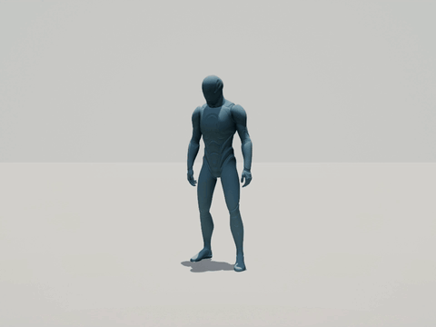
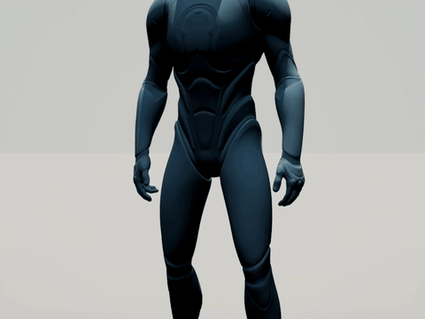
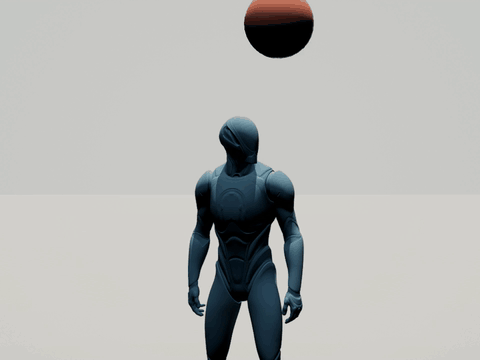
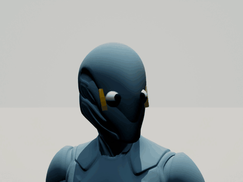
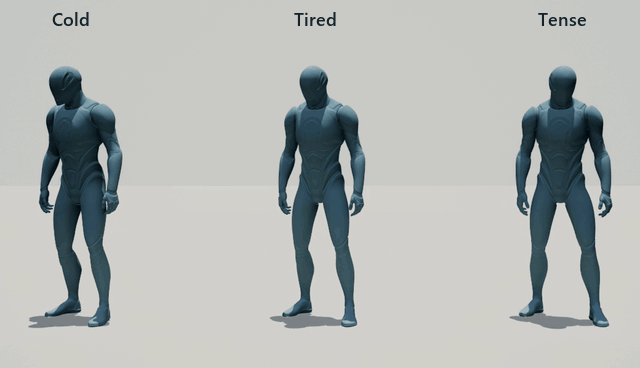
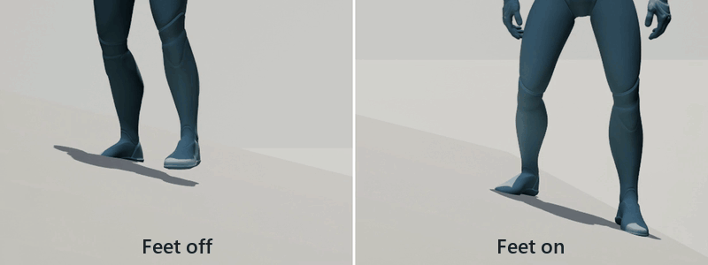
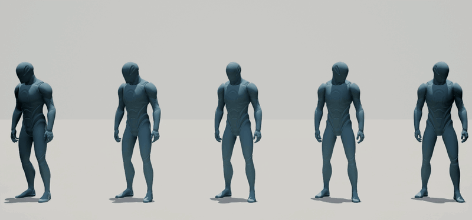

# Idle Weaver

Idle Weaver is an Unreal Engine 5.8 plugin that makes standing NPCs look alive. It layers small movements on top of a pose or animation you already have, and every character gets its own rhythm.

  

Same mesh, same pose, same preset. The only difference is Master Intensity: 0 on the left, 1 on the right.

Idle Weaver is a layer. It won't make a character walk, sit or dance. It makes one that's standing, sitting or waiting feel like someone's in there.

Every clip on this page is the real plugin running on the default Unreal mannequin with stock presets. The only tweak: in the gaze clips, the red ball has a raised weight so the head keeps following it. The source code isn't in this repo. The plugin is sold on Fab.

## What it adds

| | |
|---|---|
|  **Breathing** |  **Weight shifts** |
|  **Hand fidgets** |  **Head that follows targets** |
|  **Eyes that lead the head** (test head with two eye bones) |  **Cold, tired or tense, set from gameplay** |

Feet stay planted on uneven ground:

And no two characters move alike, even with the same mesh and pose:

## Start here

1. [Install the plugin](docs/installing.md)
2. [Give your character a pose](docs/pose-library.md)
3. [Pick a preset, or tune your own](docs/profiles-and-presets.md)

Stuck? [Troubleshooting](docs/troubleshooting.md) covers the A-pose, characters that don't move, gaze, feet, eyes and MetaHumans. Every setting, node and function is in the [reference](docs/reference.md).

## Good to know

- It needs Unreal Engine 5.8 on Windows. Other platforms aren't tested.
- The Fab install comes compiled, so it works in Blueprint-only projects.
- Everything works from both Blueprint and C++.
- It has six presets: Villager, Guard, Merchant, Crowd, Exhausted and Nervous.
- MetaHumans and other multi-mesh characters are supported. The setup is in the [reference](docs/reference.md#path-c-a-metahuman-or-any-character-built-from-several-meshes).
- You can bake the result to a normal Animation Sequence.

What changed in each version is in the [changelog](CHANGELOG.md).

## Support

Email arazcreates@gmail.com with your Unreal Engine version and the `LogIdleWeaver` lines from the Output Log.
