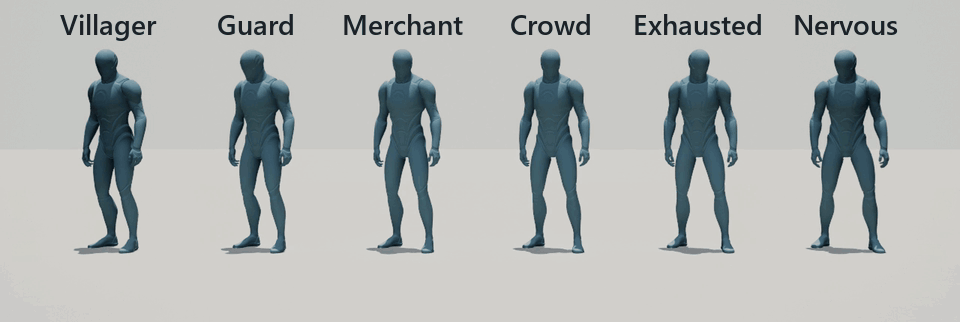
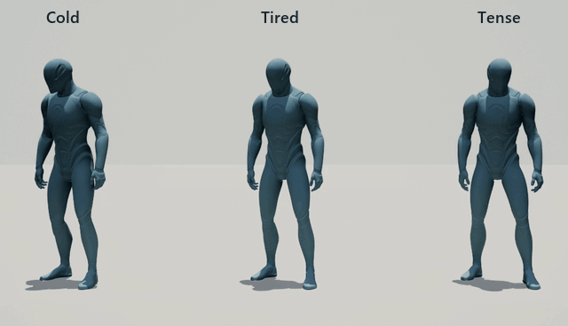
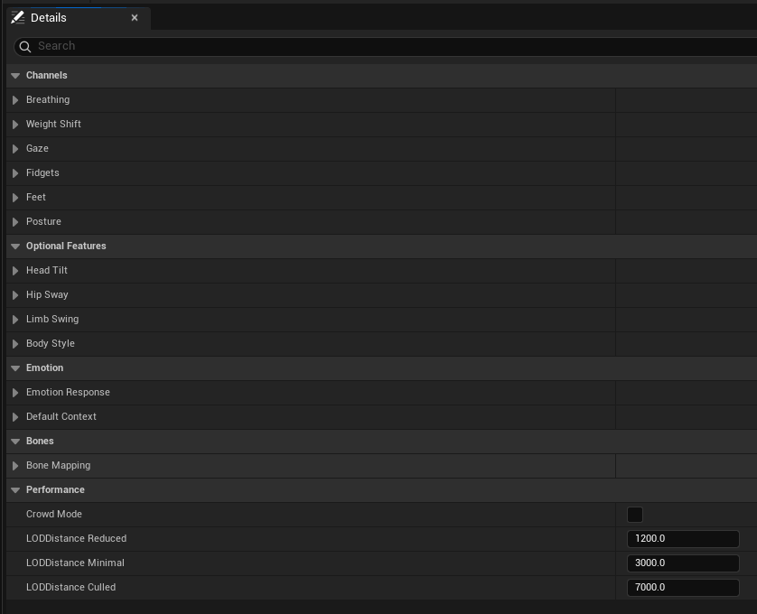
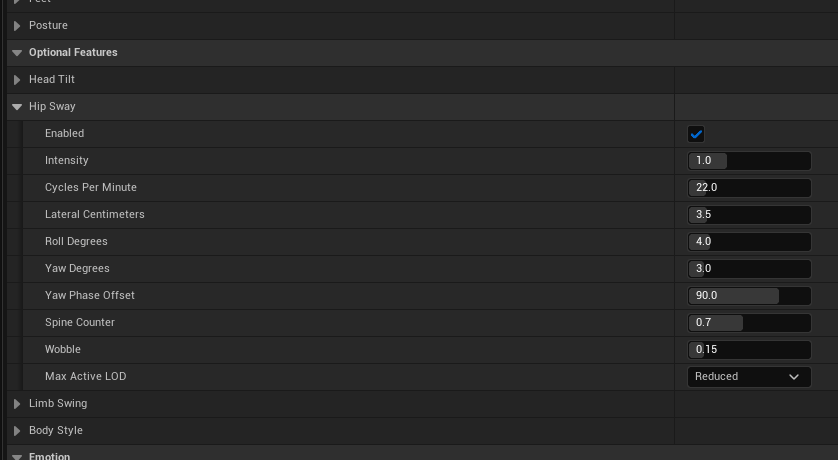
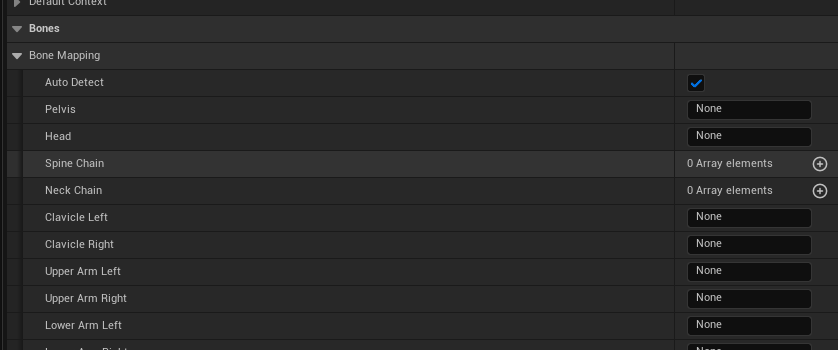

# Presets and Profiles

[Back to the main page](../README.md)

A **preset** is a ready-made character type. A **profile** is an asset that holds every setting, so you can tune a character type yourself and share it between NPCs.

Start with a preset. Make a profile only when no preset fits.

## The six presets

Select one in the **Preset** field of the Idle Weaver component.

These six share the same mesh, pose and seed, so the preset is the only difference. Master Intensity is 1.75 here so the differences read at GIF size. The default is 1.

| Preset | Reads as | Breathing | Weight shifts | Head and eyes | Hands | Other |
|---|---|---|---|---|---|---|
| **Villager** | Relaxed, neutral | Normal | Every 7 to 20 seconds | Calm | Normal | The base that all other presets start from |
| **Guard** | Still, watchful | Shallow, few sighs | Rare and small | Fast, wide turns | Almost still | No settle steps |
| **Merchant** | Warm, lively | A little deeper | Often, and large | Uses the neck more | Busy | More posture variety |
| **Crowd** | Background filler | A little deeper | Normal | Weaker, wanders more | Off | Cheapest. No ground traces. Short LOD distances |
| **Exhausted** | Tired, heavy | Slow and deep, many sighs | Large and slow | Slow, with a lower upward limit | Quiet | Low Energy |
| **Nervous** | Tense, restless | Fast | Very often | Eyes dart often | Very busy | High Tension. Takes settle steps more often |

A preset also sets the starting mood (Tension and Energy). You can change the mood at any time with **Set Tension** and **Set Energy**. This is often all you need: one preset with two different moods reads as two different people.

From left to right: Temperature -1, the Exhausted preset with Energy 0, and the Nervous preset with Tension 1.

To change the preset while the game runs, call **Set Preset** on the component.

## When to make a profile

Make a profile when you want to:

- Change a value that a preset does not give you.
- Enable an optional feature: Head Tilt, Body Style, Hip Sway or Limb Swing.
- Set bone names by hand for an unusual rig.
- Share one tuned setup between many NPCs.

## Create a profile

1. In the Content Browser, right-click an empty area.
2. Select **Data > Data Asset**. The menu is shown in [Make a Pose Library](pose-library.md#create-the-asset).
3. In the class list, select **Idle Weaver Profile**.
4. Give the asset a name, for example `IWP_TownGuard`.
5. Open the asset and change the values you want.
6. Select your character's **Idle Weaver** component and set **Profile** to the asset.

An assigned profile replaces the preset completely.

To start from a preset, call **Load Preset** on the profile from Blueprint or C++. It fills the core channels with the preset's values. It keeps your Bone Mapping and your optional features.

## What is inside a profile

| Section | What you find there |
|---|---|
| **Channels** | The six core channels: Breathing, Weight Shift, Gaze, Fidgets, Feet, Posture. Each has an **Enabled** switch and an **Intensity** slider. |
| **Optional Features** | Head Tilt, Hip Sway, Limb Swing and Body Style. All are off until you enable them. |
| **Emotion** | How strongly Tension, Energy and Temperature change each channel. |
| **Bones** | Bone names for rigs that the automatic detection does not understand. Leave a field empty to detect that bone. |
| **Performance** | Crowd Mode, and the three camera distances at which the motion gets simpler. |

Open a section to see its settings. This is Hip Sway, with **Enabled** on:

Bone Mapping is for rigs the automatic detection doesn't understand. Leave a field on **None** to detect that bone:

Every setting has a tooltip. Hold the mouse over a setting name to read it.

## How to tune

1. Change one channel at a time. Set the **Intensity** of the others to 0 while you work. Set them back when you finish.
2. Use **Intensity** first. Open the detailed values only when Intensity is not enough.
3. Keep the values small. The defaults move a few degrees, and that is on purpose. Large values look like a puppet.
4. Press Play, select the NPC in the Outliner, and change **Context** on its component. You see the effect at once.

Each channel has a **Max Active LOD** setting. It is the simplest detail level at which the channel is still shown. For example, hand fidgets show only at **Full**, because nobody sees fingers from far away. When the level changes, the channel fades in or out over 0.4 seconds.

## Problems

See [Troubleshooting](troubleshooting.md).
