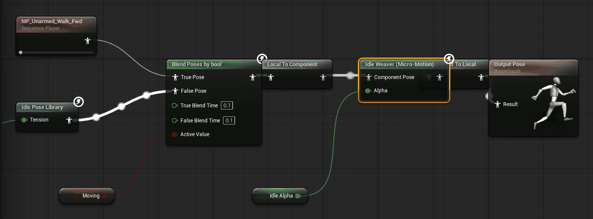
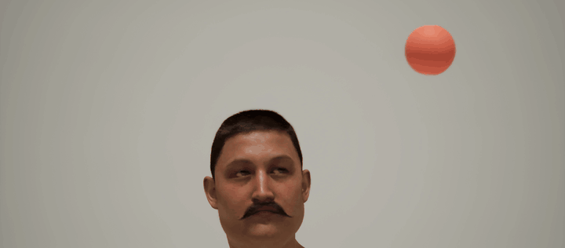

# Reference

[Back to the main page](../README.md)

Every feature, node and setting, in one page. For a step-by-step start, use the [guides](../README.md#start-here).

## What it does

| Feature | Where it is |
|---|---|
| Breathing, weight shifts, head and eye aim, hand fidgets, posture variation | **Idle Weaver (Micro-Motion)** anim node |
| Foot IK on uneven ground, feet pinned during weight shifts, small settle steps | **Idle Weaver** anim node |
| Optional extras, all off by default: Head Tilt, Body Style, Hip Sway, Limb Swing | profile, **Optional Features** section |
| A library of your own poses and idle loops, with random holds and smooth blends | **Idle Pose Library** anim node + Pose Library asset |
| Mood and weather input: Tension, Energy, Temperature | component **Context**, or pins on the node |
| Gaze targets: players, other NPCs, tagged actors, marked points of interest, random wander | **Idle Weaver** component |
| MetaHuman and other multi-mesh characters | **Target Mesh Component** + **Idle Weaver Eyes** anim node |
| Distance-based detail levels and a crowd mode | world subsystem + profile settings |
| Six presets: Villager, Guard, Merchant, Crowd, Exhausted, Nervous | component **Preset** |
| Automatic bone detection for most humanoid rigs, with manual overrides | profile **Bone Mapping** |
| The same motion on every run, for replays and cinematics | component **Deterministic** + **Seed** |
| Capture the result to a normal Animation Sequence | **Bake To Animation Sequence** button |

Every feature works from Blueprint and from C++.

## Requirements

- Unreal Engine 5.8.
- If you install the plugin from Fab into the engine, it comes compiled. You can use it in a Blueprint-only project.
- If you copy the source into a project's `Plugins` folder, you must compile it once. For this you need **Visual Studio 2022** with the *Game development with C++* workload.

## Install from source

1. Copy the `IdleWeaver` folder into `YourProject/Plugins/`. Make the `Plugins` folder if it does not exist.
2. If the project has no C++ code, open it and use **Tools > New C++ Class > None** once. This lets Unreal compile plugins.
3. Open the `.uproject` file. When Unreal asks to rebuild the missing modules, click **Yes**.
4. Make sure that **Idle Weaver** is enabled in **Edit > Plugins > Animation**.

To compile the plugin without a project:

```
"C:\Program Files\Epic Games\Unreal Engine\UE_5.8\Engine\Build\BatchFiles\RunUAT.bat" BuildPlugin -Plugin="<path>\IdleWeaver\IdleWeaver.uplugin" -Package="<output folder>" -TargetPlatforms=Win64
```

## Quick start

### Path A: a mesh without an Animation Blueprint (fastest)

1. Place an actor that has a Skeletal Mesh component. Do not assign an Animation Blueprint.
2. Add an **Idle Weaver** component to the actor.
3. Select a **Preset**. *Villager* is a good start. Or select a **Profile** asset: its **Default Context** is then copied to **Context**.
4. Optional: assign a **Pose Library** asset to give the character a base pose or idle loop. Without one, the motion plays on the reference pose (usually a T-pose or an A-pose).
5. Press Play.

At Begin Play the component installs its own anim instance on the mesh. If the mesh already has an Animation Blueprint, the component installs nothing. Use Path B for that mesh.

### Path B: inside your Animation Blueprint (full control)



1. In the AnimGraph, add the **Idle Weaver (Micro-Motion)** node. It works in component space, so Unreal adds the space conversion nodes for you.
2. Connect your idle pose to it: a state machine, a cached pose, or an **Idle Pose Library** node.
3. Optional: add the **Idle Weaver** component to the actor. The node finds it and takes the profile, context, gaze target, seed and detail level from it. Without a component, the node uses its own **Profile** and **Context** properties. The **Idle Pose Library** node also reads the component: its Tension, its seed (when the node's **Seed** is -1), **Set Idle Paused**, and its **Pose Library** (when the node has none of its own). To drive these from the node's own pins, turn on **Ignore Component** on the node.
4. Drive the node's **Alpha** from your locomotion state: 1 while idle, 0 while moving. Blend between the two so the idle motion never fights a walk or a run.

```
[Idle pose] --> [Local To Component] --> [Idle Weaver] --> [Component To Local] --> Output
```

### Path C: a MetaHuman (or any character built from several meshes)

A MetaHuman uses a Body mesh, a Face mesh, and clothing meshes that follow the body. The eye bones are on the Face mesh.

1. Add one **Idle Weaver** component to the MetaHuman actor.
2. Set its **Target Mesh Component** to **Body**.
3. In the Body Animation Blueprint, add the **Idle Weaver (Micro-Motion)** node (see Path B).
4. Duplicate **ABP_Face_PostProcess** (the original is shared by every MetaHuman in the project). Open the copy and add the **Idle Weaver Eyes** node at the very end, after RigLogic, right before **Output Pose**. In the node list it shows as **Idle Weaver Eyes (Gaze)**.
5. Open the Face skeletal mesh asset and set **Post Process Anim Blueprint** to your copy.
6. Press Play.

The Eyes node has to come after RigLogic. RigLogic rebuilds the eye joints from the face curves, so an Eyes node anywhere before it, such as in the Face Animation Blueprint, has no visible effect. With this setup, both nodes read the same component and share one gaze target and one seed, so the eyes agree with the head. The face animation keeps playing. The node turns the eyeballs only; the eyelids don't follow.



Auto-setup never installs an anim instance on a mesh that follows a Leader Pose Component, so clothing is not changed.

## Drive it from gameplay

```
IdleWeaver->SetTension(0.8);          // nervous
IdleWeaver->SetEnergy(0.15);          // tired
IdleWeaver->SetTemperature(-0.7);     // cold: closed posture, shuffling
IdleWeaver->TriggerGlanceAt(ExplosionLocation, 3.0);
IdleWeaver->SetGazeTargetActor(QuestGiver);
IdleWeaver->SetProfile(CalmProfile);  // a profile asset and its Default Context
IdleWeaver->SetIdlePaused(true);      // freeze the motion for a cutscene
```

The same functions exist as Blueprint nodes. The node in an Animation Blueprint also has **Context** pins.

Other useful functions on the component: **Set Preset**, **Set Master Intensity**, **Clear Gaze Override**, **Reseed**, **Get Effective Profile**, **Get Runtime Seed**, **Get/Set Motion LOD**, **Set Motion LOD Override**, **Get Gaze Target World**, **Get Gaze Target Serial**, **Get Head World Location**, **Resolve Mesh**, and **Find Idle Weaver Component For Mesh**. The world subsystem gives **Get Idle Components Near**, **Get Gaze Targets Near** and **Get Actors With Tag Near**.

## Gaze targets

The component picks a target every few seconds from these sources. Each source has a weight in **Gaze Targeting**.

- **Players.** Every human player counts, so split-screen and multiplayer work. **Player Search Radius** sets the range.
- **Other Idle Weaver NPCs.**
- **Tagged actors.** Set **Look At Actors With Tag**, then add the same tag to a shop, a banner or a fire (**Details > Actor > Tags**). NPCs look at the center of the actor's bounds. **Tag Search Radius** sets the range. By default an NPC looks at the spot where the tagged actor was when it picked it. Turn on **Follow Tagged Actors Live** to follow tagged actors that move.
- **Points of interest.** Add an **Idle Weaver Gaze Target** component to any actor. Its **Interest** value scales how often NPCs look at it. Turn on **Follow Live** on a target that moves, such as a carried lantern, and NPCs follow it while they look at it. With it off (the default), they look at the spot where it was when they picked it.
- **Wander.** A random point in front of the character.

Players, other NPCs and **Set Gaze Target Actor** are always followed live. Set Gaze Target Actor aims at a Pawn's eye height, at the head of another Idle Weaver character, and at the center of the bounds of any other actor.

The **FOV Degrees** cone is measured from the direction the character faces: the actor forward of a Pawn, or the forward axis (+Y) of the skeletal mesh on any other actor. The head turns with smooth springs and stops at hard limits, so a character never turns its head too far. The eyes move first and make small quick jumps.

## The core channels

To compare the presets or tune these channels, see [Presets and Profiles](profiles-and-presets.md).

- **Breathing.** Inhale is faster than exhale. The rate changes a little over time. The shoulders lift, and the neck keeps the head steady. Tired characters sigh from time to time.
- **Weight shift.** The pelvis moves and rolls toward one leg, and the spine rolls back to keep the head over the feet. A small constant sway runs on top. On a slope, the character leans uphill.
- **Gaze.** The head and neck turn toward the target and the eyes lead. With no target, the gaze drifts slowly.
- **Hand fidgets.** Fingers curl a little, and the wrists move. From time to time a hand clenches, drums its fingers, or rolls its wrist. Tension makes this stronger.
- **Feet.** Each foot traces the ground and IK places it. The pelvis drops so the lower foot can reach the ground. After a long time on one leg, the character takes a small settle step.
- **Posture variation.** A small, slow, per-character change in posture. It makes 50 characters that share one animation look like 50 different people.

## Optional features

All of these are off by default. When they are off, the motion is exactly the same as without them. Turn them on in the profile's **Optional Features** section.

- **Head Tilt.** A sideways head roll. Three styles, in any combination: lean into the gaze, a curious tilt when the NPC notices a new target, and a slow ambient drift. The roll turns about the direction the head faces, so it does not change where the character looks.
- **Body Style.** Feminine or Masculine styling with a Strength slider. It scales hip sway and roll, shoulder lift, arm position, stance width and chest. Neutral changes nothing.
- **Hip Sway.** A rhythmic sway from leg to leg, with hip roll and optional hip yaw (a figure-eight). Wobble adds a loose, irregular feel.
- **Limb Swing.** A small arm swing and a small foot lift on the free leg. It can follow the Hip Sway rhythm. Two more options are inside it, both off by default:
  - **Shoulder Offset.** Moves the shoulders forward or back: Opposed, Both Forward, Both Back, Alternating, or Custom per shoulder.
  - **Limit Inward Swing.** Caps how far the arms swing in toward the body.

## Pose Library

For a step-by-step guide, see [Make a Pose Library](pose-library.md).

A Pose Library asset holds anchors: authored poses or idle loops. The **Idle Pose Library** node holds each anchor for a random time and then blends to another one. Each anchor has a weight, a hold time range, a blend time, a play rate range and a tension range.

- Anchor animations must use the same skeleton as the mesh.
- Additive animations are skipped by default, because an additive clip collapses the pose when it plays as a full pose. The log shows a warning once per clip. To use them anyway, turn on **Allow Additive Animations** on the asset.
- If you swap the library at runtime, or change a fixed seed, the node starts a new anchor sequence.

## Performance

- The subsystem sorts NPCs into four detail levels by distance to the nearest local camera: **Full, Reduced, Minimal, Culled**. Each profile sets the distances. Each channel sets the lowest level at which it is shown. When the level changes, a channel fades in or out over 0.4 seconds, so heads and hips do not jump.
- To keep an NPC at one level (a close-up in a cinematic), use **Set Motion LOD Override**. **Set Motion LOD** sets the level only until the next pass of the subsystem.
- **Crowd mode** turns off ground traces and settle steps. The Crowd preset also turns off fidgets and uses shorter distances. To stop target scans too, turn off **Scan For Targets** on the component.
- The micro-motion node does not allocate memory on each frame.
- A dedicated server has no local camera, so it culls all idle motion.
- You can also use the engine's Update Rate Optimizations and the node's **LOD Threshold** setting.

## Determinism

Turn on **Deterministic** and set a **Seed** on the component, or set **Seed** to 0 or more on the nodes. All random motion then comes from that seed. With a fixed time step (replays, cinematics, Movie Render Queue), the motion is the same on every run, at any camera distance. Gaze target choice depends on the world, for example on who stands near the NPC. A target that leaves its search range is dropped at once. For an exact result, use **Set Gaze Target Actor** or **Trigger Glance At**, or turn off **Scan For Targets**.

## Baking

1. Select the actor in the level, in Play mode or in the editor.
2. In the Idle Weaver component, set **Bake Duration** and **Bake Frame Rate**.
3. Click **Bake To Animation Sequence**.
4. Save the new asset from the Content Browser. It is in `/Game/IdleWeaver/Baked/`.

The bake captures the full output of the mesh: the Pose Library, the micro-motion, and anything else the Animation Blueprint does. In Play mode it starts from the NPC's current motion and does not reset the NPC. The clip does not loop by itself. Bake a longer clip than you need, or blend the ends in the animation editor.

## Rigs and retargeting

Bones are found on their own on the UE4 and UE5 mannequins, Mixamo, 3ds Max Biped and MetaHuman rigs. On any other rig, or if a bone is picked wrong, set it by hand in the profile's **Bone Mapping**.

A baked clip is a normal Animation Sequence, so the IK Retargeter can use it.

## Art direction tips

- The defaults are small on purpose: degrees, not tens of degrees. Add one channel at a time.
- Give characters a Pose Library of 2 to 4 authored anchors. Let the micro-motion play on top.
- Use Tension and Energy instead of a new profile for each NPC. One profile with different moods reads as different people.
- If an NPC holds a prop, set **Fidgets Intensity** to 0 on its profile, or mask the hand with Layered Blend per Bone.

## Known limits

For fixes to common problems, see [Troubleshooting](troubleshooting.md).

- Idle Weaver adds motion on top of the incoming pose. If your base animation already turns the head, the gaze turn adds to it.
- Target selection does not check line of sight.
- The settle step is a small correction, not locomotion.
- Compiled and checked on Unreal Engine 5.8, Win64, with zero warnings in the plugin modules. Other platforms are not tested.
