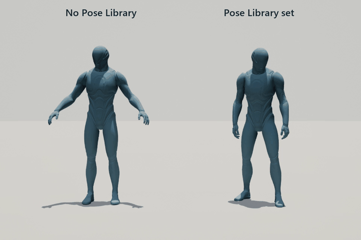
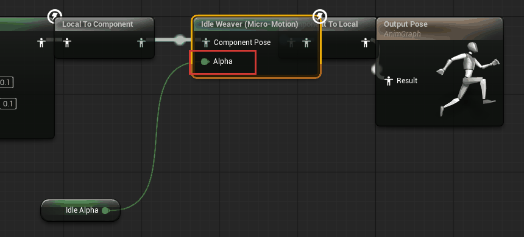
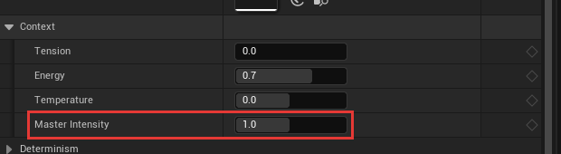
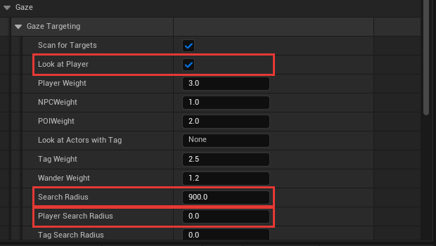
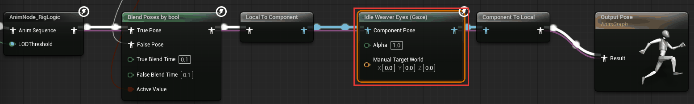
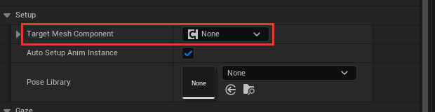
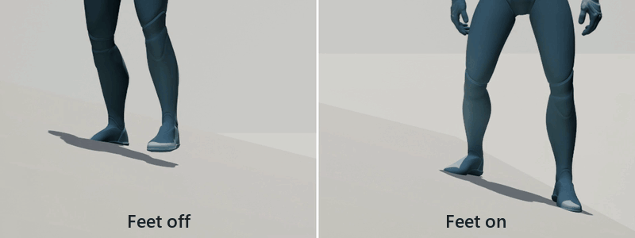
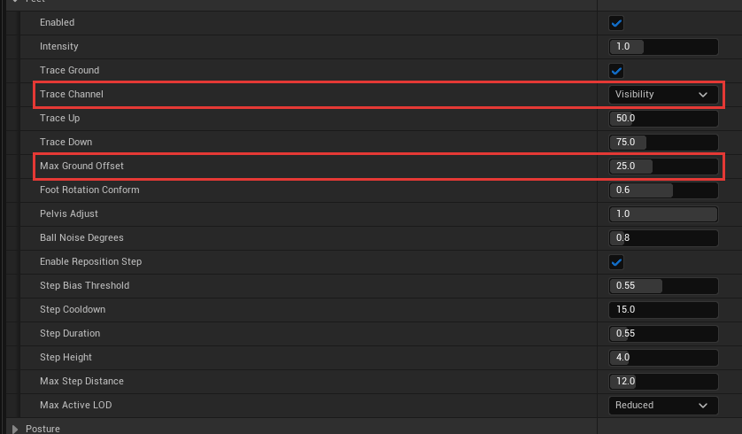
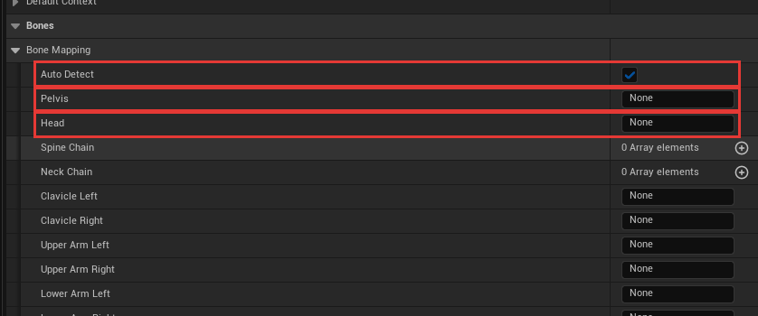

# Troubleshooting

[Back to the main page](../README.md)

Find your problem in the list. Each entry gives the usual cause first.

The plugin writes its messages to the **Output Log** under the name `LogIdleWeaver`. Open **Window > Output Log** and type `LogIdleWeaver` in the filter box to see them.

## The character stands in an A-pose or a T-pose

The character has no base pose. Idle Weaver adds motion on top of a pose, and it does not make the pose.

- **Mesh without an Animation Blueprint:** assign a **Pose Library** on the component. See [Make a Pose Library](pose-library.md).
- **Mesh with an Animation Blueprint:** connect an idle pose to the input of the **Idle Weaver** node.
- **You assigned a Pose Library and nothing changed:** the animations in it may be additive, or made for a different skeleton. Check the Output Log for a warning.

## Nothing moves

Check these in order:

1. **The mesh has an Animation Blueprint.** The component then installs nothing by itself. Add the **Idle Weaver (Micro-Motion)** node to that Animation Blueprint.
2. **The node's Alpha is 0.** Make sure that your Animation Blueprint sets Alpha to 1 while the character is idle.
3. **Master Intensity is 0** in the component's **Context**.
4. **Something paused the motion.** Your game called **Set Idle Paused** with *true*.
5. **The camera is far away.** The motion gets simpler with distance and stops fully at the last distance. Raise the LOD distances in the profile.
6. **Auto Setup Anim Instance is off** on the component.

Check 2, in the Animation Blueprint. The value connected to **Alpha** must be 1 while the character is idle:

Check 3, on the component:

## The character moves too little, or too much

The defaults are small on purpose. Change **Master Intensity** in the component's **Context** first. It scales everything. For one channel only, change that channel's **Intensity** in a profile. See [Presets and Profiles](profiles-and-presets.md).

## The character does not look at the player

- **Out of range.** The default range is 900 cm. Raise **Search Radius** or **Player Search Radius** in **Gaze Targeting**.
- **Outside the view cone.** The player must be inside **FOV Degrees**, measured from the direction the character faces. A Pawn or Character faces its actor forward. Any other actor faces the +Y axis of its skeletal mesh, as the Unreal mannequin does.
- **The mesh does not face +Y.** On an actor that is not a Pawn, a mesh that faces another axis turns the cone to its side. Rotate the mesh so that it faces +Y, or set **FOV Degrees** to 360. (Before version 1.8.0, a plain Skeletal Mesh Actor with the mannequin also had this problem.)
- **Look At Player is off**, or **Player Weight** is 0.
- **Scan For Targets is off.**
- **The Gaze channel is off** in the profile, or its Intensity is 0.
- **Other targets win.** The NPC picks among players, other NPCs, tagged actors, points of interest and wander. Raise **Player Weight** to make it look at the player more often.

The settings that matter most, in **Gaze > Gaze Targeting**. A **Player Search Radius** of 0 means it uses **Search Radius**:

## The head turns to the wrong side

The plugin has the wrong idea of where "forward" is for this mesh. Select the **Idle Weaver** node in the Animation Blueprint, open the advanced settings, and set **Forward Axis** by hand. Try **Plus Y** first for a mannequin-style mesh, then **Plus X**.

On a mesh without an Animation Blueprint there is no node to set. The plugin then uses the actor's forward direction on a Pawn or Character, and the mannequin's direction on other actors.

## The head turns too far, or not far enough

Change **Max Yaw Degrees**, **Max Pitch Up Degrees** and **Max Pitch Down Degrees** in the profile's Gaze channel. If your own idle animation already turns the head, the gaze turn adds to it.

## The eyes do not move

- **The rig has no eye bones.** The plugin then adds a small eye-like movement to the head.
- **The eye bones have unusual names.** Set **Eye Left** and **Eye Right** in the profile's **Bone Mapping**.
- **MetaHuman:** the eyes are on the Face mesh, and RigLogic in the face's post-process Animation Blueprint rebuilds them. An Eyes node in the Face Animation Blueprint has no visible effect. Put the **Idle Weaver Eyes** node at the very end of a copy of **ABP_Face_PostProcess**, after RigLogic, and set the copy as the Face mesh's **Post Process Anim Blueprint**. See [Path C](reference.md#path-c-a-metahuman-or-any-character-built-from-several-meshes). The end of the graph looks like this:

  

- **The eyes move the wrong way** on the Eyes node: set **Yaw Scale** or **Pitch Scale** to -1.

## A MetaHuman: the wrong part moves, or nothing moves

Set **Target Mesh Component** on the component to **Body**. A MetaHuman has several skeletal meshes, and the component otherwise takes the first one it finds. Then follow [Path C](reference.md#path-c-a-metahuman-or-any-character-built-from-several-meshes).

## The feet float above the ground, or go below it

- **The ground has no collision** for the trace. The feet trace on the **Visibility** channel by default. Give the ground collision that blocks Visibility, or change **Trace Channel** in the profile's Feet channel.
- **The step is too high.** A foot moves at most **Max Ground Offset** (25 cm by default). Raise it for rough ground.
- **Ground traces are off.** Crowd Mode disables them. They also stop at the far detail levels.
- **Your base pose does not stand at the mesh origin.** The plugin expects the animated feet to rest at the height of the mesh component.

This is what the channel does on a slope:

Both settings named above are in the profile, in **Channels > Feet**:

## The feet slide, or the legs look stiff

Lower **Max Pelvis Offset** in the Weight Shift channel. Large hip movement pulls the legs straight. For a sitting character, disable the Feet and Weight Shift channels.

## The hands or fingers do not move

- Fidgets run only at the **Full** detail level, so move the camera close.
- The Crowd preset disables fidgets.
- The rig may have no finger bones. The wrists still move.
- If the character holds a prop, set the Fidgets **Intensity** to 0 on purpose.

## The arms go through the legs with Limb Swing

Lower **Arm Swing Degrees**. You can also enable **Limit Inward Swing**. Or enable **Shoulder Offset**, which moves the arms a little to the front or the back of the body.

## Some body part does not move at all on my rig

The automatic bone detection did not find that bone. Make a profile, open **Bone Mapping**, and type the bone names for the parts that do not move. Leave the other fields on **None**. See [Presets and Profiles](profiles-and-presets.md).

## All characters move in the same way

**Deterministic** is on and they share one **Seed**. Give each character a different seed, or disable Deterministic.

## The motion fights my walk or run animation

Idle Weaver is for a character that stands or sits. In your Animation Blueprint, set the node's **Alpha** to 1 while idle and to 0 while moving. Use a short blend between the two.

## A Pose Library clip makes the body collapse

The clip is additive. Disable **Allow Additive Animations** again, or use a normal animation.

## The pose jumps each time an anchor loops

The first and last frame of the clip do not match. Fix the clip, or set the anchor's **Mode** to **Static Pose**.

## I baked an animation and cannot find it

It is in `Content/IdleWeaver/Baked`. The editor does not save a new baked asset by itself. Save it from the Content Browser, or you lose it when you close the editor.

## The project does not open after I copied the plugin in

Unreal must compile a plugin once when you copy it as source. Install **Visual Studio 2022** with the *Game development with C++* workload. Then open the project again and click **Yes** on the rebuild question. See [Install Idle Weaver](installing.md). The Fab version comes compiled and does not need this.

## Still stuck?

Write to arazcreates@gmail.com. Include your Unreal Engine version, what you did, and the `LogIdleWeaver` lines from the Output Log.
